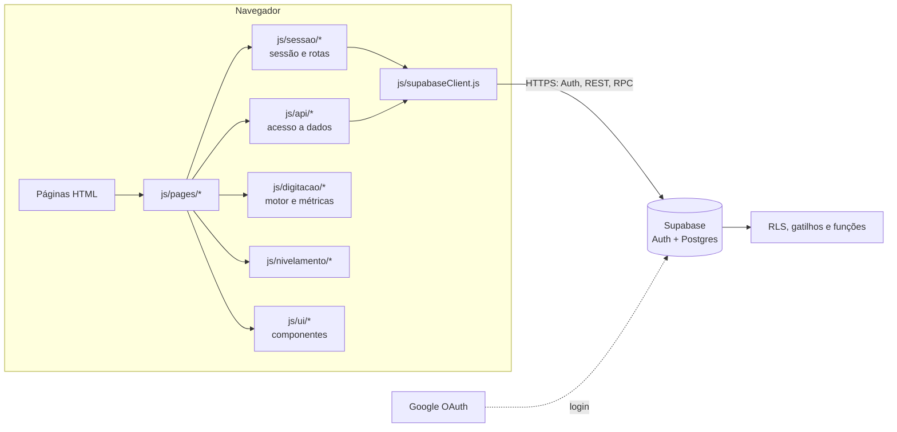
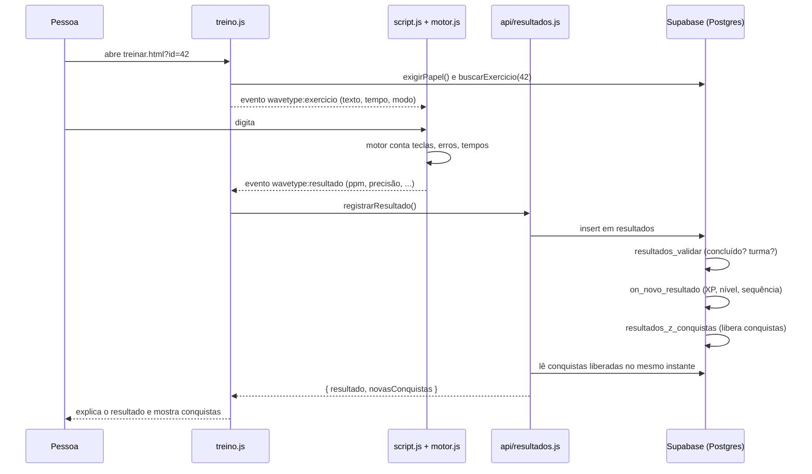

# 01 · Arquitetura

## Resumo

A WaveType é um **site multipágina estático** (HTML + CSS + JavaScript em
módulos ES, sem framework) que fala direto com o **Supabase** (Postgres,
Auth e API REST/RPC). O build é feito pelo **Vite** e a hospedagem é na
**Vercel**.

Não existe servidor próprio: **as regras de negócio que precisam ser
confiáveis moram no banco** (gatilhos, funções `security definer` e Row Level
Security). O navegador só desenha a tela e repete as regras para explicá-las.

| Camada | Tecnologia | Onde |
| --- | --- | --- |
| Páginas | HTML5 semântico, uma página por tela | `*.html`, `app/**/*.html` |
| Estilo | CSS puro com tokens (variáveis CSS) | `css/`, `css/redesign/`, `assets/css/` |
| Comportamento | JavaScript ES2022 em módulos | `js/` |
| Componentes visuais | Web Components nativos (`<wave-*>`) | `js/ui/onda.js` |
| Dados e autenticação | `@supabase/supabase-js` 2.x | `js/supabaseClient.js`, `js/api/`, `js/auth.js` |
| Banco | PostgreSQL (Supabase) com RLS | `schema.sql`, `supabase/migrations/` |
| Build | Vite 5 (multi-entrada) | `vite.config.js` |
| Hospedagem | Vercel (Production + Preview) | painel da Vercel |
| Testes | `node:test`, Playwright, SQL | `tests/`, `supabase/testes/` |

## Visão de componentes



### Princípios de arquitetura

1. **Lógica pura separada do DOM.** Motor de digitação, métricas, regras de
   sessão, nivelamento e geração de credenciais são funções puras, testadas
   com `node --test` sem navegador.
2. **O banco é a fonte da verdade.** Conclusão de exercício, XP, sequência,
   conquistas, matrícula e permissões são decididos no Postgres.
3. **Uma página, um módulo.** Cada HTML carrega um módulo em `js/pages/` que
   orquestra a tela.
4. **Sem dependências desnecessárias.** A única dependência de produção é o
   `@supabase/supabase-js`.
5. **O site público não baixa o Supabase** para quem nunca entrou. O estado do
   cabeçalho é decidido por um script no `<head>` só olhando se há token salvo.
6. **Contrato estável com o HTML** por `id`, `name` e atributos `data-*`
   (ver [MAPA-DE-INTEGRACAO.md](../MAPA-DE-INTEGRACAO.md)).

## Estrutura de pastas

```text
WaveType/
├── index.html                 Página inicial com o teste público
├── escolas.html               Apresentação para escolas
├── como-funciona.html         Método e métricas
├── sobre.html                 Empresa: origem, missão, valores
├── nivelamento.html           Teste de nivelamento
├── login.html                 Entrar (e-mail/Google ou usuário da escola)
├── cadastro.html              Criar conta / concluir cadastro (?completar=1)
├── recuperar-senha.html       Pedir link de nova senha
├── redefinir-senha.html       Definir nova senha (destino do link)
├── app/
│   ├── usuario/               Área da conta pessoal
│   ├── aluno/                 Área do aluno (inclui turmas.html)
│   ├── professor/             Área do professor (turmas, alunos, exercícios, relatórios)
│   └── redirecionando.html    Endereço antigo do retorno OAuth (só repassa)
├── js/
│   ├── supabaseClient.js      Cliente Supabase único
│   ├── auth.js                Cadastro, login, vínculos, senha
│   ├── regras.js              Regras de conclusão (espelho do banco)
│   ├── exercicios-dados.js    Estrutura da trilha (níveis e etapas)
│   ├── script.js              Interface do teste de digitação (DOM)
│   ├── site.js                Tema e menu do site público
│   ├── motion.js              Revelação ao rolar (só apresentação)
│   ├── api/                   Acesso a tabelas e RPCs, por assunto
│   ├── contas/                Geração de usuário e senha de aluno
│   ├── digitacao/             Motor, métricas e configuração
│   ├── nivelamento/           Configuração e regras do nivelamento
│   ├── pages/                 Um módulo por página
│   ├── sessao/                Sessão, proteção de rotas, cabeçalho
│   └── ui/                    Componentes e utilidades de interface
├── css/
│   ├── style.css              CSS original do site público
│   ├── platform.css           CSS original da plataforma
│   ├── exercicios.css         CSS original da trilha
│   └── redesign/              Camadas do redesenho (tokens, app, site, onda...)
├── assets/                    Fontes, logos, ícones e CSS do protótipo
├── supabase/
│   ├── migrations/            Migrações em ordem (idempotentes)
│   ├── testes/                Testes SQL do banco
│   ├── templates/             E-mails em português (cadastro e senha)
│   ├── diagnostico.sql        Quais migrações estão aplicadas
│   └── verificacao.sql        Conferência da trilha e dos dados
├── schema.sql                 Esquema original (antes das migrações)
├── tests/                     Testes de regra e e2e
├── docs/                      Esta documentação
├── html/                      Cópia isolada da área pública (backup para integração)
├── vite.config.js             Build multipágina e checagem das chaves
├── site.webmanifest           Manifesto do aplicativo web
└── package.json
```

> A pasta `html/` e `assets/css/wavetype.css` são do protótipo visual de
> setembro de 2026. Não são usadas pelo build atual (o Vite só lê `*.html` da
> raiz e `app/**/*.html`).

## Build (`vite.config.js`)

1. **Entradas:** todo `*.html` da raiz e de `app/**` vira uma entrada do
   Rollup. Não há roteador: cada arquivo é uma página.
2. **Variáveis:** procura a URL e a chave do Supabase em vários nomes
   (`VITE_SUPABASE_URL`, `SUPABASE_URL`, `NEXT_PUBLIC_SUPABASE_URL` e
   equivalentes para a chave `ANON`/`PUBLISHABLE`), dando prioridade a
   `process.env` (Vercel) sobre arquivos `.env`.
3. **Proteção da chave:** se a chave for secreta (`sb_secret_…`) ou um JWT com
   `role: service_role`, o build **falha**.
4. **Sem variáveis:** na Vercel o build falha com uma mensagem que lista os
   nomes encontrados (nunca os valores); localmente só avisa.
5. **Pré-conexão:** injeta `<link rel="preconnect">` para a origem do Supabase
   em todas as páginas.
6. Os valores são embutidos via `define` em `import.meta.env.*`.

Saída em `dist/`.

## Fluxo de dados: um treino do começo ao fim



## Ambientes

| Ambiente | Onde | Variáveis |
| --- | --- | --- |
| Desenvolvimento | `npm run dev` em `http://localhost:5173` | `.env.local` (`vercel env pull .env.local`) |
| Preview | Vercel, a cada push em branch (`*-cmkcogit.vercel.app`) | Environment Variables › Preview |
| Produção | Vercel, branch principal | Environment Variables › Production |

Configuração completa dos painéis em [CONFIGURACAO.md](../CONFIGURACAO.md).
