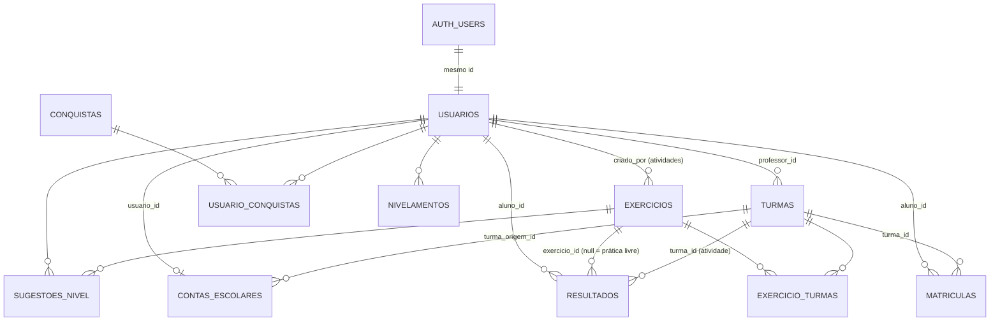

# 04 · Banco de dados (Supabase)

O banco é PostgreSQL gerenciado pelo Supabase. Ele é a **fonte da verdade** da
WaveType: decide quem vê o quê (RLS), se um resultado concluiu um exercício, o
XP, a sequência e as conquistas.

## Como o esquema é montado

1. `schema.sql` — esquema original (tabelas base, gatilhos de perfil e de XP).
2. `supabase/migrations/*.sql` — 13 migrações, aplicadas **em ordem**. Todas
   são **idempotentes** (podem rodar de novo sem duplicar) e nenhuma apaga dados.
3. `supabase/diagnostico.sql` — mostra quais migrações estão aplicadas.
4. `supabase/verificacao.sql` — confere a trilha (20 exercícios por nível) e
   inconsistências.

## Diagrama de entidades

## Tabelas

### `usuarios` — perfil (1:1 com `auth.users`)

| Coluna | Tipo | Observação |
| --- | --- | --- |
| `id` | uuid PK | = `auth.users.id`. **ID estável** de todo o progresso. |
| `nome` | varchar(120) | Editável pela pessoa |
| `email` | varchar(190) único | Sincronizado com o Auth (`sincronizar_email_usuario`) |
| `google_id` | varchar | Legado |
| `tipo` | enum `tipo_usuario` | `usuario`, `aluno`, `professor` |
| `tipo_definido` | boolean | `false` enquanto o cadastro com Google não foi concluído |
| `ativo` | boolean | Conta desativada derruba a sessão |
| `xp`, `nivel`, `sequencia_dias`, `ultima_pratica_em` | int / date | Gamificação (só o servidor altera) |
| `avatar_url` | text | Editável |
| `codigo_aluno` | varchar(8) | Código curto único (ex.: `K7Q2MX`), gerado por gatilho |
| `criado_em`, `atualizado_em` | timestamptz | |

A senha **nunca** fica aqui: só no Supabase Auth (bcrypt). Pelo navegador, a
pessoa só pode alterar `nome` e `avatar_url` (privilégio por coluna).

### `turmas`

| Coluna | Observação |
| --- | --- |
| `id` | bigint identity |
| `nome`, `descricao`, `ano_letivo` | |
| `status` | `ativa` ou `encerrada` |
| `codigo_convite` | Único; gerado e normalizado por `turmas_antes_de_salvar` |
| `modo_erros` | `fluxo`, `correcao` ou null (migração 08) |
| `professor_id` | Dono da turma |
| `criado_em`, `atualizado_em` | |

### `matriculas`

`aluno_id`, `turma_id`, `ativa`, `entrou_em`; único por (aluno, turma).
Entrada **só pelas RPCs** (`entrar_na_turma` com código válido, ou
`adicionar_aluno*` pelo professor). O professor pode só alterar `ativa`.

### `exercicios` — trilha oficial e atividades

| Coluna | Observação |
| --- | --- |
| `titulo`, `texto_referencia`, `instrucoes` | |
| `nivel_trilha` (1–6), `ordem` (1–20) | Preenchidos = **trilha oficial**. Nulos = **atividade de professor**. |
| `tempo_limite_seg` | Trilha: calculado por gatilho. Atividade: definido pelo professor (10–3600 s). |
| `meta_precisao` | Precisão mínima da atividade |
| `prazo` | Data limite da atividade |
| `nivel` | `facil`, `medio`, `avancado` (rótulo) |
| `publicado` | Rascunho ou publicado |
| `criado_por` | Professor (null na trilha) |
| `turma_id` | Legado; a ligação atual é `exercicio_turmas` |

### `exercicio_turmas`

Liga uma atividade a várias turmas: PK (`exercicio_id`, `turma_id`), `atribuido_em`.

### `resultados`

| Coluna | Observação |
| --- | --- |
| `aluno_id` | Dono (qualquer papel) |
| `exercicio_id` | null = prática livre |
| `turma_id` | Turma em que a atividade foi registrada (decidida pelo banco) |
| `ppm`, `precisao`, `acertos`, `erros`, `tempo_seg` | Métricas |
| `concluiu_texto` | false se o tempo acabou antes do fim |
| `tempo_limite_seg` | Copiado do exercício no momento |
| `concluido` | **Decidido pelo gatilho** `resultados_validar` |
| `criado_em` | |

Resultados não podem ser alterados nem apagados pelo navegador.

### `conquistas` e `usuario_conquistas`

`conquistas`: catálogo (`codigo`, `titulo`, `descricao`, `icone`, `categoria`,
`criterio`, `meta`, `ordem`, `papeis` — null = todos). Leitura pública.

`usuario_conquistas`: (`usuario_id`, `conquista_id`, `desbloqueada_em`). **Só o
servidor** insere.

### `contas_escolares` (migração 09)

| Coluna | Observação |
| --- | --- |
| `usuario_id` | PK, o aluno |
| `login` | Usuário da escola: `^[a-z0-9]+(\.[a-z0-9]+)*$`, 3–60 caracteres |
| `criada_por` | Professor |
| `turma_origem_id` | Turma em que foi criada |
| `status` | `escolar` (gerida pela escola) ou `pessoal` (transferida) |
| `senha_redefinida_em`, `transferida_em`, `criada_em` | |

### `tentativas_login_escolar` (migração 09)

`login`, `falhas`, `janela_inicio`, `bloqueado_ate`. Inacessível ao navegador.
**8 falhas em 15 minutos → bloqueio de 10 minutos.**

### `nivelamentos` e `sugestoes_nivel` (migração 10)

`nivelamentos`: `nivel` (`iniciante`…`avancado`), `licao_nivel`, `licao_ordem`,
`precisao_media`, `ppm_medio`, `teclas_frageis[]`, `detalhes` (jsonb por etapa).

`sugestoes_nivel`: `exercicio_id`, `recomendado_nivel`, `recomendado_ordem`,
`decisao` (`aceitou` / `ignorou`).

## Funções chamadas pelo navegador (RPC)

Todas `security definer`, com `search_path` fixo, executáveis só por
`authenticated` (exceto `login_escolar`, liberada também para `anon` porque
precisa funcionar antes do login).

### Cadastro e conta

| Função | O que faz |
| --- | --- |
| `concluir_cadastro(p_tipo, p_nome)` | Conclui cadastro do Google. Aceita `usuario` ou `professor` (não `aluno`). Confere a gravação. |
| `alterar_tipo_conta(p_tipo)` | Trocas permitidas entre tipos pessoais. Não promove a professor, não cria aluno, não converte conta escolar. |
| `login_escolar(p_login, p_senha)` | Confere usuário + senha (bcrypt) com limite de tentativas e devolve o e-mail interno; resposta igual para usuário inexistente e senha errada. |
| `minha_conta_escolar()` | Dados da conta escolar do próprio aluno. |
| `transferir_conta_escolar()` | Exige e-mail ou Google vinculado. Sai das turmas e vira pessoal. |

### Professor: turmas e alunos

| Função | O que faz |
| --- | --- |
| `resumo_turmas_professor()` | Resumo por turma (alunos, médias), sem dados anteriores a transferências. |
| `alunos_da_turma(p_turma_id)` | Lista alunos com métricas. |
| `adicionar_aluno(p_turma_id, p_identificador)` | Adiciona por código curto ou UUID. |
| `adicionar_aluno_por_id(p_turma_id, p_aluno_id)` | Adiciona pelo ID. |
| `remover_aluno_da_turma(p_turma_id, p_aluno_id)` | Desativa a matrícula. |
| `regenerar_codigo_turma(p_turma_id)` | Novo código de convite. |
| `excluir_turma(p_turma_id)` | Exclui (recusa se houver resultados). |
| `professor_criar_alunos(p_turma_id, p_alunos jsonb)` | Cria até 60 contas: usuário único (sufixo em colisão), e-mail interno `<id>@aluno.wavetype.com.br`, senha como hash, matrícula. |
| `professor_redefinir_senha_aluno(p_aluno_id, p_senha)` | Nova senha; encerra as sessões abertas. |
| `professor_alterar_login_aluno(p_aluno_id, p_login)` | Troca o usuário da escola (progresso e senha mantidos). |

### Professor: atividades

| Função | O que faz |
| --- | --- |
| `salvar_atividade(...)` | Cria ou edita atividade (título, instruções, texto, nível, tempo 10–3600 s, prazo, meta 0–100, publicado, turmas). |
| `excluir_atividade(p_id)` | Exclui (recusa se houver resultados). |
| `atividades_do_professor()` | Atividades com entregas por turma. |

### Aluno e usuário

| Função | O que faz |
| --- | --- |
| `entrar_na_turma(p_codigo)` | Matricula pelo código de convite. |
| `minhas_atividades()` | Atividades das turmas com situação: pendente, concluída, atrasada. |
| `ranking_exercicio(p_exercicio_id)` | Ranking do exercício (sem dados anteriores a transferências). |
| `progresso_conquistas()` | Conquistas do tipo de conta com progresso atual × meta. |
| `sincronizar_conquistas()` | Libera conquistas já alcançadas (resultados antigos). |

## Funções internas (auxiliares de RLS e regras)

| Função | Papel |
| --- | --- |
| `meu_tipo()` | Tipo do usuário logado |
| `eh_professor_da_turma(id)`, `eh_aluno_da_turma(id)`, `eh_professor_do_aluno(uuid)` | Base das políticas, sem recursão |
| `pode_ver_exercicio(id)` | Trilha: todos os logados. Atividade: dono ou aluno de turma que a recebeu. |
| `turma_tem_resultados(id)`, `exercicio_tem_resultados(id)` | Impedem exclusão com histórico |
| `conta_transferida(uuid)`, `anterior_a_transferencia(uuid, ts)` | Escondem do professor o que veio antes da transferência |
| `dominio_conta_escolar()` | `aluno.wavetype.com.br` |
| `tempo_limite_trilha(texto, nivel)`, `precisao_minima_trilha(nivel)` | Regras da trilha (85%) |
| `metricas_conquistas`, `calcular_conquistas`, `avaliar_conquistas`, `liberar_conquista` | Motor de conquistas |
| `gerar_codigo_convite()`, `gerar_codigo_aluno()` | Códigos curtos sem caracteres confusos |

## Gatilhos

| Gatilho | Tabela / momento | Função | Efeito |
| --- | --- | --- | --- |
| `on_auth_user_created` | `auth.users` após insert | `handle_new_user` | Cria o perfil. Google nasce com `tipo_definido = false`; pedido de "aluno" fica incompleto. |
| `on_auth_user_email_updated` | `auth.users` após update de `email` | `sincronizar_email_usuario` | Copia o e-mail novo para `usuarios`. |
| `usuarios_codigo_aluno` | `usuarios` antes de insert/update | `usuarios_codigo_aluno` | Gera o código curto. |
| `turmas_antes_de_salvar` | `turmas` antes de insert/update | `turmas_antes_de_salvar` | Gera/normaliza o código de convite (só muda pela RPC), impede trocar o dono, `atualizado_em`. |
| `exercicios_tempo_trilha` | `exercicios` antes de insert/update de texto ou nível | `exercicios_tempo_trilha` | Calcula o tempo da trilha. |
| `resultados_validar` | `resultados` antes de insert | `resultados_validar` | Confere dono, cadastro completo, acesso à atividade; define `turma_id`, `tempo_limite_seg` e `concluido`. |
| `on_novo_resultado` | `resultados` após insert | `handle_novo_resultado` | XP, nível e sequência de dias. |
| `resultados_z_conquistas` | `resultados` após insert | `resultados_avaliar_conquistas` | Libera conquistas (o prefixo `z` garante que roda por último). |

## Row Level Security (resumo)

RLS está **ligada em todas as tabelas**. Além das políticas, os privilégios de
tabela/coluna são reduzidos ao mínimo.

| Tabela | Ler | Escrever |
| --- | --- | --- |
| `usuarios` | O próprio perfil | Só `nome` e `avatar_url` do próprio |
| `turmas` | Professor dono ou aluno matriculado | Professor dono (`meu_tipo() = 'professor'`); excluir só sem resultados |
| `matriculas` | O próprio aluno ou o professor da turma | Só por RPC; professor altera `ativa` |
| `exercicios` | `pode_ver_exercicio` | Professor, só atividades próprias (`nivel_trilha` nulo) |
| `exercicio_turmas` | Professor ou aluno da turma | Professor da turma, com atividade própria |
| `resultados` | O próprio; professor da turma, **exceto anteriores à transferência** | Inserir só o próprio; nunca alterar/apagar |
| `conquistas` | Todos (inclusive anônimos) | Ninguém |
| `usuario_conquistas` | O próprio | Só o servidor |
| `contas_escolares` | O próprio aluno; professor com o aluno ativo numa turma sua, enquanto a conta for `escolar` | Só por RPC |
| `tentativas_login_escolar` | Ninguém | Só por RPC |
| `nivelamentos`, `sugestoes_nivel` | O próprio; professor do aluno, exceto anteriores à transferência | Inserir só o próprio |

## Migrações

| # | Arquivo | Assunto |
| --- | --- | --- |
| 01 | `20261027000001_perfis_e_cadastro_google.sql` | Tipo `usuario`, `tipo_definido`, `concluir_cadastro`, bloqueio de UPDATE em tipo/XP |
| 02 | `20261027000002_turmas_atividades_rls.sql` | Atividades multi-turma, colunas novas, **todas as políticas RLS** recriadas sem brechas nem recursão |
| 03 | `20261027000003_trilha_nivel_extremo.sql` | Exercício 20 de cada nível, Nível 6 (Extremo), `resultados_validar` |
| 04 | `20261027000004_conquistas_gamificacao.sql` | Catálogo com critério/meta e cálculo no servidor |
| 05 | `20261028000005_tempo_maximo_e_precisao.sql` | Tempo máximo da trilha, precisão > 85%, tempo e meta nas atividades |
| 06 | `20261029000006_correcao_cadastro_google.sql` | `tipo_definido` NOT NULL, conferência em `concluir_cadastro`, recarga do cache da API |
| 07 | `20261030000007_codigo_aluno_e_tipo_conta.sql` | Código curto do aluno, `alterar_tipo_conta`, `adicionar_aluno` por código |
| 08 | `20261105000008_modo_erros_turma.sql` | `turmas.modo_erros` |
| 09 | `20261105000009_contas_escolares.sql` | Contas escolares, login com usuário, limite de tentativas, transferência |
| 10 | `20261105000010_nivelamento.sql` | `nivelamentos` e `sugestoes_nivel` |
| 11 | `20261105000011_transferencia_nos_relatorios.sql` | Dados anteriores à transferência fora de tudo que o professor vê |
| 12 | `20261105000012_trocar_usuario_aluno.sql` | `professor_alterar_login_aluno` |
| 13 | `20261106000013_aluno_so_pelo_professor.sql` | Conta de aluno só pelo professor (garantia no banco) |

### Regras para escrever uma migração nova

1. Nome `AAAAMMDDNNNNNN_assunto.sql`, número sequencial.
2. **Idempotente**: `if not exists`, `create or replace`, `drop policy if exists`,
   `on conflict do nothing/update`.
3. **Nunca destrutiva** sem plano explícito: não apague colunas nem dados.
4. Funções `security definer` com `set search_path = public` e `revoke … from
   public, anon` antes do `grant … to authenticated`.
5. Termine com `notify pgrst, 'reload schema';` quando criar/alterar funções ou
   colunas usadas pela API.
6. Adicione um teste em `supabase/testes/` e atualize
   [CONFIGURACAO.md](../CONFIGURACAO.md) com a ordem de execução.
7. Rode a migração **antes** de publicar o front que depende dela.
