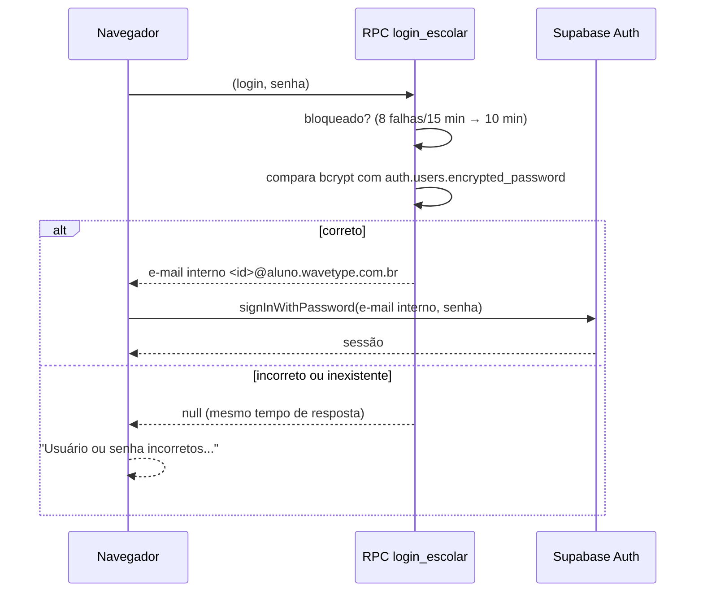

# 05 · Autenticação, sessão e contas

## Princípio

> **O front-end cuida da navegação; o banco cuida da segurança.**

Os guardas de página (`exigirPapel`) só decidem para onde a pessoa vai. Quem
protege os dados é a RLS, com políticas baseadas em `auth.uid()` e
`meu_tipo()`, e as RPCs, que recusam quem não tem o papel certo. Ver
[04 · Banco de dados](04-banco-de-dados.md#row-level-security-resumo).

## Papéis

| Papel (`usuarios.tipo`) | Área | Como nasce |
| --- | --- | --- |
| `usuario` | `/app/usuario/` | Cadastro público (e-mail ou Google), escolhendo "Usuário" |
| `professor` | `/app/professor/` | Cadastro público, escolhendo "Professor" |
| `aluno` | `/app/aluno/` | **Só pelo professor** (`professor_criar_alunos`) |

Desde a migração 13, o banco recusa criar aluno pelo cadastro público,
`concluir_cadastro` recusa "aluno" e `alterar_tipo_conta` não troca
usuário → aluno nem promove ninguém a professor. Contas de aluno antigas
continuam como estão.

## Formas de entrar

| Método | Função (`js/auth.js`) | Detalhes |
| --- | --- | --- |
| E-mail e senha | `entrarComEmailSenha` | `signInWithPassword` |
| Google | `entrarComGoogle({ origem })` | OAuth; volta para `/login.html` ou `/cadastro.html` na origem atual (local, preview ou produção) |
| Usuário da escola | `entrarComUsuarioDaEscola({ login, senha })` | RPC `login_escolar` devolve o e-mail interno; depois `signInWithPassword` normal |

Todas terminam numa sessão do Supabase Auth ligada a um `user_id`. Depois,
`irParaArea(perfil)` grava o papel da sessão, marca atividade, entrega o perfil
para a próxima página (economiza uma ida ao servidor) e redireciona.

### Login com usuário da escola, em detalhe

- Usuário inexistente executa um `crypt` de mesmo custo, para não revelar
  quem existe pelo tempo de resposta.
- O limite de "sign-ins" do Supabase Auth também se aplica.

### Cadastro

1. **E-mail:** `cadastrarUsuario({ nome, email, senha, tipo })` → `auth.signUp`.
   O perfil é criado **pelo gatilho** `on_auth_user_created`; o front nunca
   insere em `usuarios`.
2. **Google:** o perfil nasce com `tipo_definido = false`. A pessoa cai em
   `/cadastro.html?completar=1`, escolhe o tipo e chama
   `concluirCadastro({ tipo, nome })`, que confere no banco se gravou.
3. Senha: `validarSenha` aplica as regras mínimas no front; o Supabase valida
   de novo.

### Recuperação de senha

1. `/recuperar-senha.html` → `solicitarRecuperacaoSenha(email)`. A resposta é a
   mesma exista ou não a conta.
2. O link do e-mail abre `/redefinir-senha.html` com uma sessão de recuperação;
   `definirNovaSenha(senha)` grava.
3. Modelos de e-mail em português: `supabase/templates/`.

## Camada de sessão (`js/sessao/`)

### Estados e decisões

`validarSessao()` confere a sessão **no servidor** (`auth.getUser`) e devolve
`valida`, `invalida` (token expirado ou usuário removido) ou `ausente`.

`decidirAcessoArea()` (pura, em `regras.js`) decide, nesta ordem:

| Situação | Ação | Destino |
| --- | --- | --- |
| Sem sessão | `login` | `/login.html?redirect=<página>` |
| Sessão inválida | `derrubar` | login com `motivo=expirada` |
| Conta desativada | `derrubar` | login com `motivo=desativada` |
| Cadastro incompleto | `redirecionar` | `/cadastro.html?completar=1` |
| Papel mudou no servidor | `derrubar` | login com `motivo=papel` |
| Aluno inativo > 30 min | `derrubar` | login com `motivo=inatividade` |
| Papel diferente da área | `redirecionar` | área do próprio papel |
| Caso contrário | `permitir` | — |

`decidirPaginaDeAcesso()` faz o mesmo para login/cadastro: com sessão válida,
a pessoa nunca fica parada na tela de login.

### Proteção contra *open redirect*

`redirectInternoSeguro()` só aceita `?redirect=` que:

- comece com `/` (e não com `//`), sem caracteres de controle nem `\`;
- tenha no máximo 512 caracteres;
- resolva para a mesma origem e para um caminho em `/app/`, sem `..`.

Além disso, `destinoAposLogin()` só usa o redirect se ele for da área do
papel da pessoa (aluno nunca é levado ao painel do professor).

### Vigilância durante o uso

Depois de `exigirPapel()` liberar a página, `vigiarSessao()`:

- escuta **logout em outra aba** (BroadcastChannel, com o evento `storage`
  como plano B);
- escuta `SIGNED_OUT` do Supabase (sessão revogada ou expirada);
- registra atividade em `keydown`, `pointerdown`, `touchstart` e `scroll`
  (gravada no máximo a cada 15 s, compartilhada entre abas);
- confere a inatividade a cada 30 s e ao voltar para a aba.

### Sair

`encerrarSessao()`:

1. Revoga a sessão no servidor com `scope: 'local'` (outros aparelhos da mesma
   pessoa continuam conectados).
2. `limparDadosLocais()`: remove tokens e dados `wavetype_*`, mantendo só as
   preferências do aparelho (tema e acessibilidade).
3. Avisa as outras abas.
4. Vai para o destino, com a mensagem do motivo.

### Mensagens de motivo (`MENSAGENS_MOTIVO`)

| `motivo` | Mensagem |
| --- | --- |
| `expirada` | Sua sessão expirou. Entre novamente. |
| `inatividade` | Sua sessão foi encerrada por inatividade. Entre novamente. |
| `outra_aba` | Você saiu da sua conta em outra aba. |
| `papel` | O tipo da sua conta mudou. Entre novamente. |
| `desativada` | Esta conta está desativada. Fale com o professor ou com a escola. |
| `saiu` | Você saiu da sua conta. |

### Cabeçalho público sem Supabase

Um script no `<head>` marca `data-sessao` como `carregando` (há token salvo)
ou `visitante`. `sessao/cabecalho.js` só baixa o Supabase quando há token, e
então mostra o menu da conta (nome, "Meu painel", "Sair"). Quem nunca entrou
não carrega o cliente do Supabase.

## Contas escolares

### Modelo

| Onde | O que fica |
| --- | --- |
| `usuarios` | Perfil. O `id` é estável: resultados, conquistas e matrículas apontam para ele. |
| `auth.users` / `auth.identities` | Credenciais: senha (bcrypt), e-mail, Google. |
| `contas_escolares` | Usuário da escola, quem criou, turma de origem, `escolar` / `pessoal`. |
| `tentativas_login_escolar` | Limite de tentativas. |

A conta recebe o e-mail interno `<id>@aluno.wavetype.com.br`, que nunca recebe
mensagens. Como usa o **ID** (e não o usuário), trocar o usuário não muda o
login interno.

### Usuário e senha (`js/contas/credenciais.js`)

| Regra | Exemplo |
| --- | --- |
| Minúsculas, sem acento, partes separadas por ponto | `Maria Silva Santos` → `maria.silva.santos` |
| Partículas ignoradas (da, de, do, dos…) | `José da Conceição` → `jose.conceicao` |
| Nomes longos: primeiro + dois últimos | `Ana Beatriz Ferreira Lima Costa` → `ana.lima.costa` |
| Colisão ganha número | `maria.silva2` |
| Senha: palavra simples sem acento + 3 algarismos de 2 a 9 | `tucano472` |

O front **sugere**; o banco (`professor_criar_alunos`) confere o formato e
resolve as colisões de verdade.

### Fluxos do professor

| Ação | Onde | RPC |
| --- | --- | --- |
| Cadastrar um aluno | Perfil › "Cadastrar aluno" | `professor_criar_alunos` |
| Criar em lote (até 60) | Alunos › "Criar alunos sem e-mail" | `professor_criar_alunos` |
| Imprimir/copiar acessos | Cartões de acesso (`ui/cartoes-acesso.js`) | — |
| Nova senha | Lista de alunos | `professor_redefinir_senha_aluno` (encerra as sessões do aluno) |
| Trocar usuário | Lista de alunos | `professor_alterar_login_aluno` |

A senha inicial aparece **uma única vez**, nos cartões. O banco guarda só o hash.

### Vínculo e transferência (aluno)

| Ação | Função | Requisitos |
| --- | --- | --- |
| Vincular Google | `vincularGoogle()` | "Allow manual linking" ligado no Supabase |
| Vincular e-mail | `vincularEmail(email)` | "Secure email change" **desligado** (o e-mail interno não recebe mensagens) |
| Transferir ao terminar a escola | `transferirContaEscolar()` → RPC `transferir_conta_escolar` | Ter Google ou e-mail real vinculado |

Na transferência, o banco desativa as matrículas, marca a conta como `pessoal`
e muda o tipo para `usuario`. O progresso continua (mesmo ID). Pela migração
11, tudo o que veio **antes** da transferência sai do que o professor vê:
resultados, médias, entregas, ranking da atividade, nivelamento e sugestões.

## Configurações obrigatórias no Supabase

| Painel | Configuração |
| --- | --- |
| Authentication › URL Configuration | Site URL de produção; Redirect URLs para produção, previews (`https://*-cmkcogit.vercel.app/**`) e `http://localhost:5173/**` |
| Authentication › Providers › Google | Client ID e Secret; Callback URL no Google Cloud |
| Authentication › Sign In / Providers | **Allow manual linking: ligado**; **Secure email change: desligado** |
| Authentication › Emails | Modelos de `supabase/templates/` |
| Project Settings › Authentication › SMTP | SMTP próprio para produção |

Passo a passo em [CONFIGURACAO.md](../CONFIGURACAO.md).

## Checklist de segurança

- [x] Só a chave `anon`/`publishable` vai para o navegador (o build bloqueia a `service_role`).
- [x] RLS em todas as tabelas; privilégios mínimos por coluna.
- [x] Funções `security definer` com `search_path` fixo e `grant` explícito.
- [x] Senhas só no Supabase Auth (bcrypt).
- [x] Respostas de login e recuperação não revelam contas existentes.
- [x] Limite de tentativas no login da escola.
- [x] Validação de `?redirect=` contra *open redirect*.
- [x] Sessão validada no servidor, não só no `localStorage`.
- [x] Saída por inatividade para alunos (computadores compartilhados).
- [x] Conclusão, XP e conquistas decididos no servidor.
