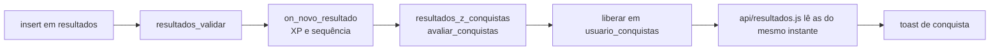

# 06 · Nivelamento e gamificação

## Teste de nivelamento

**Página:** `nivelamento.html` · **Módulo:** `js/pages/nivelamento.js` ·
**Regras:** `js/nivelamento/avaliacao.js` · **Limites:** `js/nivelamento/config.js`

### Como funciona

São **5 etapas progressivas** de até **35 s** cada (no máximo ~3 minutos),
sempre em modo fluxo. O teste **para na primeira etapa com precisão abaixo de
80%** (`PRECISAO_PARA_AVANCAR`).

| # | `id` | Etapa | Mede |
| --- | --- | --- | --- |
| 1 | `base` | Fileira base | A S D F G H J K L Ç |
| 2 | `superior-inferior` | Fileiras de cima e de baixo | Q a P e Z a M |
| 3 | `palavras` | Palavras simples | Todas as letras |
| 4 | `acentos` | Acentos e pontuação | Acentos, cedilha, vírgula, ponto |
| 5 | `frases` | Frases | Frase completa, ritmo |

### Recomendação

| Parou em | Nível | Lição de início (nível · exercício) |
| --- | --- | --- |
| `base` | Iniciante | 1 · 1 (ou 1 · 6 se a precisão ≥ 65%: pula F e J) |
| `superior-inferior` | Básico | 2 · 1 (ou 3 · 1 se errou mais na fileira de baixo) |
| `palavras` | Básico | 4 · 6 |
| `acentos` | Intermediário | 5 · 1 |
| `frases` | Intermediário | 5 · 11 |
| Passou em tudo, ≥ 35 WPM e ≥ 92% | Avançado | 6 · 1 |
| Passou em tudo, abaixo disso | Intermediário | 5 · 16 |

A saída (`recomendar(resumos)`) traz também:

- **teclas frágeis**: até 5 teclas com mais erros somados;
- **região mais frágil**: fileira base, de cima, de baixo, acentos, pontuação ou espaço;
- precisão e WPM médios;
- uma **explicação em linguagem simples** do porquê da recomendação.

### Onde o resultado vai

| Situação | O que acontece |
| --- | --- |
| Com sessão | `salvarNivelamento()` grava em `nivelamentos`. |
| Visitante | `guardarNivelamentoPendente()` guarda no navegador (vale 7 dias) e oferece criar conta. |
| Ao entrar | `ui/ponto-de-partida.js` chama `enviarNivelamentoPendente()` e mostra o cartão "Seu ponto de partida". |
| Professor | Vê o ponto de partida e as sugestões aceitas/ignoradas na lista de alunos (`nivelamentoDosAlunos`). |

## Sugestões durante o treino

Depois de cada resultado na trilha, `pages/treino.js` chama
`sugestaoDuranteTreino()`. A sugestão **não bloqueia**: é um aviso com
"Ir para a lição recomendada" e "Continuar mesmo assim".

**Quando aparece** (`SUGESTAO` em `config.js`):

- (a) precisão **abaixo de 70%** em **2 tentativas seguidas** do mesmo
  exercício; **ou**
- (b) numa tentativa, **3 ou mais teclas** com taxa de erro **≥ 40%**, cada
  uma com pelo menos **3 aparições** (a mensagem cita essas teclas);

**e** o exercício está **acima** da lição recomendada. Atividades de professor
nunca recebem sugestão. Sem nivelamento, a sugestão é fazer o teste.

**Como a recomendação muda** (`licaoRecomendadaAtual`):

- **Aceitar** fixa a recomendação na lição sugerida.
- **Ignorar 3 vezes seguidas** sobe a recomendação **uma etapa** (5 lições):
  a pessoa mostrou que quer avançar.

Cada decisão é gravada em `sugestoes_nivel` (`registrarDecisaoDeSugestao`).

## XP, nível e sequência

Gatilho `on_novo_resultado` → `handle_novo_resultado()`, a cada resultado:

| Item | Regra |
| --- | --- |
| XP ganho | `10 + max(0, floor(precisão − 90))` (ex.: 97% → 17 XP) |
| Nível | `1 + floor(xp / 200)` |
| Sequência | +1 se a última prática foi ontem; mantém se foi hoje; volta a 1 se passou mais de um dia |

Esses campos só podem ser alterados pelo servidor (o navegador não tem
privilégio de UPDATE neles).

## Conquistas

**Catálogo:** tabela `conquistas` (migração 04). **Cálculo:** no banco, a
partir dos resultados reais. **Tela:** `pages/conquistas.js` só apresenta.

### Fluxo

Ao abrir a tela de conquistas, `sincronizar_conquistas()` libera o que já foi
alcançado (cobre resultados anteriores à gamificação) e
`progresso_conquistas()` devolve atual × meta de cada uma. Nada é liberado só
por abrir a tela: o banco confere os números.

### Critérios disponíveis

| `criterio` | Mede |
| --- | --- |
| `exercicios_concluidos` | Exercícios da trilha concluídos |
| `melhor_precisao` | Maior precisão em uma sessão concluída |
| `sessoes_sem_erros` | Sessões com zero erros |
| `sessoes_precisao_95` | Sessões com ≥ 95% |
| `melhor_ppm` | Maior WPM |
| `evolucao_ppm` | Ganho de WPM em relação à primeira sessão |
| `etapas_completas` | Etapas (5 exercícios) completas |
| `nivel_completo` | Nível específico completo (meta = número do nível) |
| `sequencia_dias` | Dias seguidos |
| `sessoes` | Total de sessões |
| `caracteres` | Caracteres digitados no total |
| `extremo_98` | 98% em exercício do Nível 6 |
| `atividades_concluidas`, `atividades_no_prazo` | Atividades de professor (só alunos) |
| `primeiro_ranking` | 1º lugar no ranking da turma (só alunos) |

### Catálogo por categoria

| Categoria | Conquistas |
| --- | --- |
| Exercícios | Primeiros passos (1) · Aquecendo os dedos (10) · Dedicação (50) · Centurião (100) |
| Precisão | Precisão em foco (98%) · Sem erros (1) · Mira certeira (25 × 95%) · Perfeccionista (10 sem erros) |
| Velocidade | Ritmo inicial (20 WPM) · Digitador veloz (40) · Turbo (60) · Mestre 80 WPM · Evolução real (+10) · Outro patamar (+25) |
| Níveis | Etapa vencida · Base sólida (N1) · Meio caminho (12 etapas) · Teclado inteiro (N3) · Fluência (N5) · Domou o Extremo (N6) |
| Constância | Pegando o ritmo (3 dias) · Sequência de 7 dias · Hábito formado (30) · Frequentador (25 sessões) · Maratonista (10.000 caracteres) |
| Desafios | Precisão cirúrgica (98% no Extremo) · Primeira entrega* · Pontualidade (5 no prazo)* · Aluno exemplar (10)* · Turma nota 10 (1º no ranking)* |

\* Só para alunos (`papeis = {aluno}`).

### Adicionar uma conquista

1. Nova migração com `insert into public.conquistas (...) on conflict (codigo) do update ...`.
2. Use um `criterio` existente; para um critério novo, estenda
   `metricas_conquistas()` e `calcular_conquistas()`.
3. Escolha um ícone de `js/ui/icones.js` (ou adicione um SVG lá).
4. Teste com `supabase/testes/` e confira na tela de conquistas.
